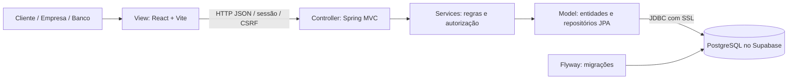

<p align="center"></p>

# Rota — Sistema de Aluguel de Carros

Aplicação web para clientes solicitarem aluguéis e acompanharem sua análise, enquanto empresas e bancos gerenciam a frota, avaliam pedidos e executam contratos.

Projeto acadêmico do **Laboratório 02 de Desenvolvimento e Integração de Aplicações Web (DIAW)**, do curso de Engenharia de Software. Documentação organizada a partir do template fornecido pelo professor João Paulo Carneiro Aramuni.

## Status do projeto

Código da aplicação e documentação disponíveis neste repositório. Back-end compilado com JDK 25, **20 testes aprovados** e conexão real com PostgreSQL no Supabase validada localmente. Cada instalação precisa de suas próprias credenciais em `backend/.env`. O Flyway cria as tabelas; as contas e os automóveis são cadastrados pela interface.

## Índice

- [Links úteis](#links-úteis)
- [Sobre o projeto](#sobre-o-projeto)
- [Atendimento ao enunciado](#atendimento-ao-enunciado)
- [Funcionalidades principais](#funcionalidades-principais)
- [Tecnologias utilizadas](#tecnologias-utilizadas)
- [Arquitetura](#arquitetura)
- [Instalação e execução](#instalação-e-execução)
- [Deploy](#deploy)
- [Estrutura de pastas](#estrutura-de-pastas)
- [Contas de demonstração](#contas-de-demonstração)
- [Demonstração](#demonstração)
- [Testes](#testes)
- [Documentações utilizadas](#documentações-utilizadas)
- [Autores](#autores)
- [Contribuição](#contribuição)
- [Agradecimentos](#agradecimentos)
- [Licença](#licença)

## Links úteis

- [Repositório GitHub](https://github.com/barskosa/DiawLab2)
- [Logins de teste para avaliação](#contas-de-demonstração)
- [Requisitos e rastreabilidade](docs/REQUISITOS.md)
- [Histórias de usuário e critérios de aceite](docs/HISTORIAS-USUARIO.md)
- [Modelagem UML e comparação das versões](docs/MODELAGEM.md)
- [Contrato da API](docs/API-CONTRACT.md)
- [Roteiro da apresentação](docs/ROTEIRO-APRESENTACAO.md)

## Sobre o projeto

O Rota centraliza o processo de aluguel de automóveis: cadastro do contratante, solicitação de período e veículo, parecer financeiro de um agente e emissão de contrato quando aprovado. Clientes, empresas e bancos acessam o mesmo servidor pela aplicação React, com permissões verificadas pelo Spring Boot.

O escopo segue o enunciado do Laboratório 02. As decisões complementares necessárias à implementação, como regras de datas e de transição de status, estão identificadas em [Requisitos](docs/REQUISITOS.md). Os modelos conceituais e os modelos correspondentes ao código estão preservados separadamente em `docs/uml/v1` e `docs/uml/v2`.

## Atendimento ao enunciado

O enunciado estabelece três critérios de avaliação: **adequação aos requisitos**, **alinhamento entre modelos e código** e **atualização dos modelos**. A tabela relaciona os entregáveis a evidências verificáveis no repositório.

| Requisito ou entregável | Implementação e evidência |
| --- | --- |
| Java 25, Spring Boot 4.0.x e Maven | [pom.xml](backend/pom.xml), Maven Wrapper e API compilada com JDK 25 |
| React + Vite, PostgreSQL/Supabase e MVC | [Front-end](frontend/package.json), [configuração JDBC e Flyway](backend/src/main/resources/application.properties) e [diagrama de pacotes MVC](docs/uml/v2/pacotes.svg); conexão real com Supabase validada |
| Cadastro e login obrigatório para clientes e agentes | [AuthController](backend/src/main/java/br/com/rota/controller/AuthController.java), [SecurityConfig](backend/src/main/java/br/com/rota/config/SecurityConfig.java) e testes HTTP de sessão, credenciais e autorização |
| CRUD de cliente e identificação completa | [ClientController](backend/src/main/java/br/com/rota/controller/ClientController.java) e [AuthService](backend/src/main/java/br/com/rota/service/AuthService.java); nome, CPF, RG, endereço, profissão e até três vínculos com empregador e rendimento |
| Criar, consultar, modificar e cancelar pedidos; acompanhar status | [OrderController](backend/src/main/java/br/com/rota/controller/OrderController.java), páginas React e testes de criação, edição, cancelamento e isolamento entre clientes |
| Agentes modificam e avaliam pedidos; parecer positivo antes do contrato | [RentalService](backend/src/main/java/br/com/rota/service/RentalService.java); testes de análise financeira, invalidação do parecer após edição e bloqueio de contratação sem aprovação |
| Automóveis e propriedade de cliente, empresa ou banco | [Vehicle](backend/src/main/java/br/com/rota/model/Vehicle.java) e [RentalContract](backend/src/main/java/br/com/rota/model/RentalContract.java); matrícula, ano, marca, modelo, placa e titularidade definida na contratação |
| Contrato de crédito opcional concedido por banco agente | Associação ao banco, valor, juros e parcelas em `RentalContract`; teste que restringe a concessão ao próprio banco autenticado |
| Casos de uso, histórias, classes e pacotes | [Modelos UML](docs/MODELAGEM.md) em fontes PlantUML e SVG, além das [histórias de usuário com critérios de aceite](docs/HISTORIAS-USUARIO.md) |
| Comparação dos modelos iniciais com o código final | Versões `v1` e `v2` preservadas; [comparação das versões e justificativas](docs/MODELAGEM.md#comparação-das-versões-e-justificativas) explica as decisões de implementação |
| Qualidade e demonstração do protótipo | **20 testes aprovados**, build React concluído, verificações no navegador, capturas de tela e [roteiro de apresentação](docs/ROTEIRO-APRESENTACAO.md) |

A [matriz de rastreabilidade](docs/REQUISITOS.md) detalha os requisitos funcionais, a stack exigida, as permissões e as decisões complementares. As suítes [RentalFlowTest](backend/src/test/java/br/com/rota/RentalFlowTest.java) e [HttpSecurityTest](backend/src/test/java/br/com/rota/HttpSecurityTest.java) permitem reproduzir as verificações das regras de negócio e da API.

## Funcionalidades principais

- Cadastro e login com usuário e senha; sessão protegida e saída da conta.
- CRUD do próprio cadastro de cliente, incluindo RG, CPF, nome, endereço, profissão e até três vínculos de empregador/rendimento.
- Consulta e edição dos dados de clientes pelos agentes.
- Cadastro, consulta, alteração e exclusão de automóveis pelos agentes, com matrícula, ano, marca, modelo e placa.
- Criação, consulta, alteração e cancelamento de pedidos pelos clientes.
- Edição de pedidos e avaliação financeira com parecer por empresas e bancos.
- Contratação somente após aprovação, com propriedade vinculada a cliente, empresa ou banco.
- Crédito opcional concedido pelo banco autenticado, registrando valor, taxa e parcelas no contrato.
- Separação de acesso entre clientes e agentes, validação no servidor e prevenção de aluguéis contratados em períodos conflitantes.

## Tecnologias utilizadas

| Camada | Tecnologia | Uso |
| --- | --- | --- |
| Linguagem do servidor | Java, JDK 25 | Requisito do laboratório |
| Back-end | Spring Boot 4.0.9 / Spring MVC | API e arquitetura MVC |
| Segurança | Spring Security / BCrypt | Sessões, papéis, senha e CSRF |
| Persistência | Spring Data JPA / Hibernate | Mapeamento de entidades e repositórios |
| Banco | Supabase, PostgreSQL | Persistência da execução normal |
| Migrações | Flyway | Criação versionada do esquema `rental` |
| Build Java | Apache Maven / Maven Wrapper | Dependências, testes e empacotamento |
| Front-end | React + Vite / JavaScript / CSS | Páginas dinâmicas e interface responsiva |
| Testes Java | JUnit / Spring Boot Test / H2 | Testes isolados, sem credenciais do Supabase |
| Modelagem | PlantUML | Casos de uso, classes e pacotes versionados |

H2 pertence exclusivamente ao ambiente de testes. A aplicação normal não substitui o Supabase por armazenamento no navegador ou banco simulado.

## Arquitetura



O subsistema de páginas usa React como **View**. O subsistema de gestão concentra **Controllers** Spring MVC, serviços de domínio e o **Model** persistido. Controllers expõem DTOs, os serviços validam permissões e transições, e os repositórios acessam PostgreSQL. A interface nunca recebe a senha do banco.

Clientes e agentes são representados por `AppUser` com papel `CLIENT`, `COMPANY` ou `BANK`. O crédito é opcional e seus dados ficam associados a `RentalContract`. As justificativas e as correspondências entre o modelo conceitual e o código estão em [Modelagem](docs/MODELAGEM.md).

### Modelos UML

| Modelo | Versão conceitual | Versão correspondente ao código |
| --- | --- | --- |
| Casos de uso | [Diagrama v1](docs/uml/v1/casos-de-uso.svg) | [Diagrama v2](docs/uml/v2/casos-de-uso.svg) |
| Classes | [Diagrama v1](docs/uml/v1/classes.svg) | [Diagrama v2](docs/uml/v2/classes.svg) |
| Pacotes / visão lógica | [Diagrama v1](docs/uml/v1/pacotes.svg) | [Diagrama v2](docs/uml/v2/pacotes.svg) |

As fontes editáveis estão nas mesmas pastas dos diagramas. A comparação documenta a centralização das credenciais em `AppUser`, os vínculos profissionais em `Employment`, a relação entre pedido e contrato e a representação do crédito opcional. O front-end corresponde ao subsistema de páginas web; o back-end concentra a gestão de pedidos e contratos.

## Instalação e execução

### Pré-requisitos

- Git.
- **JDK 25** com `JAVA_HOME` e `PATH` configurados. Java 17 não atende à versão exigida pelo enunciado.
- Node.js 22.12 ou superior compatível com o Vite usado no projeto; npm.
- Projeto PostgreSQL ativo no Supabase e sua senha de banco.
- Acesso à internet na primeira execução para baixar dependências Maven/npm.

O Maven Wrapper está em `backend/`; não é necessário instalar Maven globalmente.

### Variáveis de ambiente

Copie os arquivos de exemplo a partir da raiz do repositório:

```powershell
if (!(Test-Path backend/.env)) { Copy-Item backend/.env.example backend/.env }
if (!(Test-Path frontend/.env)) { Copy-Item frontend/.env.example frontend/.env }
```

Edite `backend/.env` com os valores do painel **Connect → Session pooler** do Supabase:

```dotenv
DB_URL=jdbc:postgresql://SEU_HOST_DO_POOLER:5432/postgres?sslmode=require
DB_USERNAME=postgres.SEU_PROJECT_REF
DB_PASSWORD=SUA_SENHA_DO_BANCO
APP_AGENT_REGISTRATION_CODE=ESCOLHA_UM_CODIGO_PRIVADO
FRONTEND_ORIGIN=http://localhost:5173,http://localhost:5174
```

Copie host e usuário do seu próprio projeto; `DB_PASSWORD` recebe a senha do banco PostgreSQL. Use o Session pooler na porta `5432` com `sslmode=require`. O arquivo é carregado como Java Properties: use `CHAVE=valor`, sem aspas externas; uma barra invertida no valor deve ser escapada como `\\`. Inicie a API dentro de `backend`, onde está o `.env`.

O código de agentes é definido por você e informado apenas ao cadastrar uma empresa ou banco. Cliente não precisa desse código. No front-end, mantenha `VITE_API_BASE_URL=` vazio para usar o proxy local.

O React utiliza a API Spring em `/api`; em desenvolvimento, o Vite encaminha as requisições para `http://localhost:8080`. **Nenhuma chave `anon`, `service_role` ou API externa é necessária.** O login é implementado no Spring Security; não é preciso configurar Supabase Auth.

### Instalação das dependências

No diretório `frontend`:

```powershell
npm.cmd ci
```

As dependências Java são baixadas automaticamente pelo Wrapper ao testar ou iniciar o back-end.

### Inicialização do banco de dados

Após preencher `backend/.env`, o Flyway cria o esquema `rental` e aplica as migrações no primeiro início. O Hibernate valida as tabelas contra as entidades. Use um projeto Supabase destinado ao trabalho; as migrações não inserem contas ou veículos fictícios.

### Como executar a aplicação

Terminal 1, dentro de `backend`:

```powershell
.\mvnw.cmd spring-boot:run
```

Terminal 2, dentro de `frontend`:

```powershell
npm.cmd run dev
```

Abra o endereço informado pelo Vite: **http://localhost:5173** por padrão, ou **http://localhost:5174** se a primeira porta estiver ocupada. Para outra porta, ajuste `FRONTEND_ORIGIN` no back-end e reinicie a API. A API atende em **http://localhost:8080/api**. Em Linux/macOS, use `./mvnw` e `npm` nos comandos equivalentes.

### Primeiro uso

1. Defina `APP_AGENT_REGISTRATION_CODE` em `backend/.env` e inicie os dois servidores.
2. Cadastre uma empresa, informe o código e entre nessa conta.
3. Cadastre ao menos um automóvel na frota.
4. Saia, cadastre um cliente com CPF válido e crie um pedido para o veículo.
5. Entre novamente como agente para analisar e aprovar o pedido, depois executar seu contrato.
6. Para demonstrar crédito, cadastre também um banco e faça a concessão autenticado nessa conta.

## Deploy

A entrega contém o código local; não há uma URL pública provisionada. Para uma publicação completa, hospede o processo Java e sirva o build React, preferencialmente no mesmo domínio com `/api` encaminhado ao Spring.

Dentro de `frontend`, gere os arquivos estáticos:

```powershell
npm.cmd run build
```

Dentro de `backend`, gere o executável:

```powershell
.\mvnw.cmd clean package
java -jar target/rota-api-1.0.0.jar
```

Configure as mesmas variáveis de banco e de agente no ambiente do servidor, além de `SESSION_COOKIE_SECURE=true` sob HTTPS. Se o front-end usar outra origem, ajuste `FRONTEND_ORIGIN`, `VITE_API_BASE_URL` e as políticas de cookies de acordo com a topologia. `VITE_API_BASE_URL` recebe a origem da API sem `/api` no final e é incorporada durante o build.

## Estrutura de pastas

```text
backend/
  .mvn/                       Configuração do Maven Wrapper
  mvnw / mvnw.cmd             Execução Maven multiplataforma
  pom.xml                     Spring Boot 4.0.9 e Java 25
  src/main/java/br/com/rota/
    config/                   Segurança e configuração
    controller/               Endpoints Spring MVC
    dto/                      Contratos de entrada e saída
    model/                    Entidades e enumerações
    repository/               Persistência Spring Data JPA
    service/                  Regras, autorização e transações
  src/main/resources/
    db/migration/             Migrações Flyway
    application.properties    Configuração sem segredos
  src/test/                   Testes e perfil test
frontend/
  public/                     Marca e recursos estáticos
  src/                        Interface React e cliente da API
  package.json                Scripts e dependências
docs/
  uml/v1/                     Modelagem conceitual inicial
  uml/v2/                     Modelagem alinhada à implementação
  API-CONTRACT.md             Endpoints e dados
  HISTORIAS-USUARIO.md        Histórias com critérios de aceite
  MODELAGEM.md                Diagramas e decisões de modelagem
  REQUISITOS.md               Requisitos e rastreabilidade
  ROTEIRO-APRESENTACAO.md      Demonstração e checklist de entrega
```

## Contas de demonstração

As contas abaixo foram preparadas na base Supabase utilizada para a apresentação, com dados fictícios e senha de teste publicada para avaliação do projeto. Os três acessos foram verificados em **3 de novembro de 2026**.

| Papel | Usuário | Senha | O que avaliar |
| --- | --- | --- | --- |
| Cliente | `cliente.teste` | `Teste123!` | Consultar e editar cadastro, criar/alterar/cancelar pedidos, acompanhar status e consultar contratos |
| Empresa | `empresa.teste` | `Teste123!` | Gerenciar a frota, consultar clientes, alterar e avaliar pedidos, executar contratos |
| Banco | `banco.teste` | `Teste123!` | Avaliar pedidos e executar contratos com crédito concedido pelo próprio banco |

Para entrar:

1. Execute o back-end e o front-end conforme [Instalação e execução](#instalação-e-execução).
2. Mantenha o back-end conectado ao **mesmo projeto Supabase** em que essas contas foram cadastradas, usando a configuração local de `backend/.env`.
3. Abra o endereço informado pelo Vite e preencha **Usuário** e **Senha** com uma das combinações da tabela.
4. Use **Sair da conta** para alternar entre os três papéis durante a avaliação.

As migrações criam a estrutura do banco; **as contas de demonstração foram cadastradas previamente nessa base**. Se outra instalação utilizar um projeto Supabase novo, prepare as contas pelos fluxos de cadastro descritos em [Primeiro uso](#primeiro-uso). O código privado de agentes é solicitado ao cadastrar empresa/banco; entrar em uma conta existente usa apenas usuário e senha.

As credenciais do banco e o código de agentes permanecem na configuração privada do servidor. Somente os acessos de aplicação destinados à demonstração estão publicados nesta seção.

## Demonstração

Siga o [roteiro de apresentação](docs/ROTEIRO-APRESENTACAO.md) para demonstrar cadastro, pedido, avaliação, contrato e crédito com contas de diferentes papéis. A interface apresenta os dados persistidos no projeto Supabase utilizado; novos bancos começam sem contas ou automóveis.

Use os [logins de demonstração](#contas-de-demonstração) para acompanhar os fluxos com cada papel. As migrações não criam usuários; as contas para apresentação são preparadas pelos próprios fluxos de cadastro, com dados de teste.

### Cenários preparados para avaliação

Na base de apresentação, o cliente `cliente.teste` possui quatro pedidos identificados como **“Demonstração para o professor”**. O automóvel é um **Fiat Argo 2025**, com diária de **R$ 150,00**, matrícula `TESTE-001` e placa `TST1A23`.

| Período de aluguel | Estado preparado | Fluxo disponível |
| --- | --- | --- |
| 10 a 13/11/2026 | Contratado | Consultar contrato com crédito de R$ 450,00, taxa de 1,5% e três parcelas, concedido pelo banco de demonstração |
| 17 a 20/11/2026 | Em análise | Cliente ou agente pode editar; agente pode emitir o parecer financeiro |
| 24 a 27/11/2026 | Aprovado | Agente pode executar o contrato; editar o pedido exige nova análise |
| 1 a 3/12/2026 | Cancelado | Consultar o histórico de cancelamento |

Os estados acima representam a preparação de **3 de novembro de 2026**. As ações realizadas durante a avaliação alteram esses registros.

### Galeria da aplicação

As **12 capturas**, realizadas em **3 de novembro de 2026**, mostram a aplicação em execução normal: React, API Java e **PostgreSQL real no Supabase**, com dados fictícios cadastrados pelos fluxos da aplicação. Clique em qualquer imagem ou em **Abrir imagem** para visualizar a captura completa.

| Login | Cadastro de cliente |
| --- | --- |
| <a href="docs/images/login.png"></a> | <a href="docs/images/cadastro.png"></a> |
| Acesso com usuário e senha para os três papéis. [Abrir imagem](docs/images/login.png) | Identificação, profissão e vínculos empregatícios. [Abrir imagem](docs/images/cadastro.png) |

| Painel do cliente | Frota de automóveis |
| --- | --- |
| <a href="docs/images/dashboard.png"></a> | <a href="docs/images/frota.png"></a> |
| Resumo dos pedidos, status e contratos do cliente. [Abrir imagem](docs/images/dashboard.png) | Consulta de automóveis e acesso à solicitação de aluguel. [Abrir imagem](docs/images/frota.png) |

| Pedidos de aluguel | Novo pedido |
| --- | --- |
| <a href="docs/images/pedidos.png"></a> | <a href="docs/images/novo-pedido.png"></a> |
| Acompanhamento dos períodos e estados das solicitações. [Abrir imagem](docs/images/pedidos.png) | Escolha do automóvel, datas, observações e estimativa de valor. [Abrir imagem](docs/images/novo-pedido.png) |

| Avaliação financeira | Clientes do sistema |
| --- | --- |
| <a href="docs/images/avaliacao.png"></a> | <a href="docs/images/clientes.png"></a> |
| Parecer do agente com aprovação ou rejeição e justificativa. [Abrir imagem](docs/images/avaliacao.png) | Consulta e edição dos dados usados na análise. [Abrir imagem](docs/images/clientes.png) |

| Cadastro do cliente | Contratos de aluguel |
| --- | --- |
| <a href="docs/images/perfil.png"></a> | <a href="docs/images/contratos.png"></a> |
| Dados pessoais, vínculos e ações de manutenção do cadastro. [Abrir imagem](docs/images/perfil.png) | Consulta dos aluguéis formalizados após aprovação. [Abrir imagem](docs/images/contratos.png) |

| Detalhes do contrato com crédito | Interface em celular |
| --- | --- |
| <a href="docs/images/contrato.png"></a> | <a href="docs/images/mobile.png"></a> |
| Propriedade registrada e condições do crédito concedido pelo banco. [Abrir imagem](docs/images/contrato.png) | Navegação e conteúdo adaptados à largura de 320 px. [Abrir imagem](docs/images/mobile.png) |

## Testes

No diretório `backend`:

```powershell
.\mvnw.cmd test
```

O perfil `test` usa H2 isolado em modo PostgreSQL, aplica as migrações Flyway e valida as entidades, sem requerer credenciais do Supabase. A execução local em **2 de novembro de 2026**, com JDK 25, terminou com **20 testes, zero falhas e zero erros**:

| Suíte | Quantidade | Comportamentos verificados |
| --- | --- | --- |
| `RentalFlowTest` | 12 | Cadastro/CPF/vínculos, perfis, permissões, pedidos, pareceres, cancelamento, contrato, crédito e períodos conflitantes |
| `HttpSecurityTest` | 8 | API HTTP real, sessão/CSRF, login/logout, convites, validação, isolamento e ciclo completo até contrato com crédito em requisições independentes |

H2 permite testar as regras e as migrações em isolamento. Também foi validada a execução normal com **PostgreSQL real no Supabase**, incluindo aplicação da migração V1, validação das entidades pelo Hibernate e consulta de autenticação pela interface com sessão/CSRF. Essa verificação de conexão é adicional à suíte de 20 testes em H2.

No diretório `frontend`:

```powershell
npm.cmd run build
```

O build da interface foi concluído. O [roteiro de apresentação](docs/ROTEIRO-APRESENTACAO.md) também lista cenários de validação manual de autorização, cancelamento, dados obrigatórios e limite de rendimentos. Os resultados acima distinguem a suíte automatizada em H2 da verificação adicional com o PostgreSQL real no Supabase.

A verificação em Chromium também confirmou cadastro de banco e cliente, cadastro de automóvel, criação e edição de pedido, cancelamento, parecer financeiro e execução de contrato com crédito, usando a API real em ambiente isolado de testes. As cinco páginas do cliente foram verificadas em larguras de **320, 425, 768 e 1440 px**, sem rolagem horizontal no documento e sem erros JavaScript. Tabelas extensas mantêm rolagem dentro do próprio componente.

## Documentações utilizadas

- [Spring Boot 4.0 — documentação oficial](https://docs.spring.io/spring-boot/4.0/index.html)
- [Spring Framework — Spring MVC](https://docs.spring.io/spring-framework/reference/web/webmvc.html)
- [Spring Security — proteção CSRF](https://docs.spring.io/spring-security/reference/servlet/exploits/csrf.html)
- [Supabase — Spring Boot e PostgreSQL](https://supabase.com/docs/guides/getting-started/quickstarts/spring-boot)
- [Supabase — conexões PostgreSQL](https://supabase.com/docs/guides/database/connecting-to-postgres)
- [React](https://react.dev/learn)
- [Vite](https://vite.dev/guide/)
- [Apache Maven Wrapper](https://maven.apache.org/wrapper/)
- [PlantUML](https://plantuml.com/)
- [Template de README da disciplina](https://github.com/joaopauloaramuni/desenvolvimento-e-integracao-de-aplicacoes-web/blob/main/TEMPLATES/template_README.md)

## Autores

**Álvaro Barbosa** — [GitHub: barskosa](https://github.com/barskosa).

## Contribuição

Consulte os requisitos e modelos antes de alterar comportamentos. Trabalhe em uma branch, valide o back-end e o build do front-end e atualize os diagramas quando houver mudança estrutural. As versões anteriores dos modelos devem ser preservadas; mudanças discutidas em aula devem ser registradas com a data e o motivo reais.

## Agradecimentos

Ao professor João Paulo Carneiro Aramuni, pelo enunciado e pelo template de documentação, e ao curso de Engenharia de Software, pelo contexto acadêmico do projeto.

## Licença

Não foi definida uma licença de distribuição. A ausência de licença não equivale a uma autorização de uso irrestrito; os responsáveis devem decidir a licença antes de eventual distribuição pública como projeto reutilizável.
