<p align="center"></p>

# Rota — Sistema de Aluguel de Carros

Aplicação web para solicitar aluguéis, acompanhar a análise financeira e formalizar contratos com empresas e bancos. Projeto do **Laboratório 02 de Desenvolvimento e Integração de Aplicações Web**, organizado a partir do template de README da disciplina.

## Status do projeto

Aplicação com React, API Java e PostgreSQL no Supabase. A versão inclui **43 testes automatizados aprovados: 30 Java e 13 do front-end**, além de verificações de integração e navegação. A execução local depende das credenciais do banco em `backend/.env`.

## Índice

- [Links úteis](#links-úteis)
- [Sobre o projeto](#sobre-o-projeto)
- [Funcionalidades principais](#funcionalidades-principais)
- [Tecnologias utilizadas](#tecnologias-utilizadas)
- [Arquitetura e modelagem](#arquitetura-e-modelagem)
- [Design System](#design-system)
- [Instalação e execução](#instalação-e-execução)
- [Contas de demonstração](#contas-de-demonstração)
- [Deploy](#deploy)
- [Estrutura de pastas](#estrutura-de-pastas)
- [Demonstração](#demonstração)
- [Testes](#testes)
- [Documentações utilizadas](#documentações-utilizadas)
- [Autores](#autores)
- [Contribuição](#contribuição)
- [Agradecimentos](#agradecimentos)
- [Licença](#licença)

## Links úteis

- [Repositório GitHub](https://github.com/barskosa/DiawLab2)
- [Requisitos e rastreabilidade](docs/REQUISITOS.md)
- [Histórias de usuário](docs/HISTORIAS-USUARIO.md)
- [Modelagem UML](docs/MODELAGEM.md)
- [Contrato da API](docs/API-CONTRACT.md)
- [Design System e tokens](docs/design-system.md)
- [Design System em PDF](frontend/public/design-system-rota.pdf)
- [Logins de demonstração](#contas-de-demonstração)

## Sobre o projeto

O Rota centraliza cadastro de contratantes, frota, pedidos, pareceres e contratos. Clientes acompanham suas solicitações; empresas e bancos analisam condições financeiras e executam contratos aprovados. O banco mantém identificação, profissão e até três vínculos de empregador/rendimento de cada cliente.

A [matriz de requisitos](docs/REQUISITOS.md) relaciona o enunciado a arquivos e testes. Os modelos preservam a evolução do conceito e da implementação em `docs/uml/v1` a `v4`.

## Funcionalidades principais

- Cadastro e login com usuário e senha, sessão e proteção CSRF.
- CRUD do cadastro de cliente com nome, CPF, RG, endereço, profissão e até três vínculos de renda.
- Cadastro, consulta, edição e exclusão de automóveis por agentes; consulta da frota pelos clientes.
- Criação, consulta, alteração e cancelamento de pedidos pelo titular.
- Edição e avaliação financeira por empresas e bancos, com identificação e rendimentos disponíveis durante o parecer.
- Contratação após aprovação, propriedade de cliente/empresa/banco e crédito opcional concedido pelo próprio banco.
- Preservação dos dados e valores contratuais após alterações no cadastro ou na frota.
- Isolamento de acesso entre clientes e prevenção de contratações simultâneas em períodos conflitantes.

## Tecnologias utilizadas

| Camada | Tecnologias |
| --- | --- |
| Front-end | React, Vite, JavaScript e CSS |
| Back-end | Java **25**, Spring Boot **4.0.9**, Spring MVC e Apache Maven |
| Segurança | Spring Security, sessão HTTP, BCrypt e CSRF |
| Persistência | Spring Data JPA, Hibernate, PostgreSQL no Supabase e Flyway |
| Testes | JUnit/Spring Boot Test, H2 restrito aos testes e executor nativo do Node.js |
| Documentação | Markdown, Mermaid e PlantUML |

## Arquitetura e modelagem

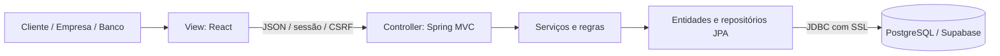

O front-end corresponde ao subsistema de páginas web. Controllers, serviços e entidades compõem a gestão de clientes, pedidos e contratos. DTOs delimitam os dados expostos; a sessão identifica o UUID do usuário. A exclusão anonimiza o cadastro e preserva os nomes já registrados em contratos.

| Modelo | Versões anteriores | Referência atual |
| --- | --- | --- |
| Casos de uso de negócio | [v1](docs/uml/v1/casos-de-uso.svg) · [v2](docs/uml/v2/casos-de-uso.svg) | [v3](docs/uml/v3/casos-de-uso.svg) |
| Classes de domínio | [v1](docs/uml/v1/classes.svg) · [v2](docs/uml/v2/classes.svg) | [v3](docs/uml/v3/classes.svg) |
| Pacotes / MVC | [v1](docs/uml/v1/pacotes.svg) · [v2](docs/uml/v2/pacotes.svg) · [v3](docs/uml/v3/pacotes.svg) | [v4](docs/uml/v4/pacotes.svg) |

As fontes `.puml`, as decisões e a comparação entre versões estão em [Modelagem](docs/MODELAGEM.md).

## Design System

A referência visual reúne cores e escalas, tipografia, espaçamentos, bordas, marca nos temas claro/escuro, ícones e componentes. Rajdhani dá aos títulos uma linguagem automotiva; Inter mantém a leitura dos formulários e tabelas. As fontes são locais, com suas licenças em `frontend/public/fonts`.

Com o front-end em execução, abra [Design System](http://localhost:5174/design). Se o Vite informar outra porta, acrescente `/design` ao endereço. A página é pública e apresenta apenas a identidade visual; os dados de negócio exigem login. Consulte os [tokens e princípios de uso](docs/design-system.md) e o [guia em PDF, com sete páginas](frontend/public/design-system-rota.pdf). **Exportar PDF** abre a impressão no tema atual; o PDF disponível para download apresenta o tema claro.

## Instalação e execução

### Pré-requisitos

- **JDK 25** com `JAVA_HOME` e `PATH` configurados.
- Node.js 22.12 ou superior compatível com Vite e npm.
- Projeto ativo no Supabase e senha do banco PostgreSQL.
- Internet para baixar dependências na primeira execução. O Maven Wrapper está incluído.

### Variáveis de ambiente

Na raiz do repositório, copie os exemplos se os arquivos locais ainda não existirem:

```powershell
if (!(Test-Path backend/.env)) { Copy-Item backend/.env.example backend/.env }
if (!(Test-Path frontend/.env)) { Copy-Item frontend/.env.example frontend/.env }
```

Em **Supabase → Connect → Session pooler**, copie host e usuário do seu projeto. Preencha `backend/.env`:

```dotenv
DB_URL=jdbc:postgresql://SEU_HOST_DO_POOLER:5432/postgres?sslmode=require
DB_USERNAME=postgres.SEU_PROJECT_REF
DB_PASSWORD=SUA_SENHA_DO_BANCO
APP_AGENT_REGISTRATION_CODE=ESCOLHA_UM_CODIGO_PRIVADO
FRONTEND_ORIGIN=http://localhost:5173,http://localhost:5174,http://localhost:4173
```

O arquivo usa Java Properties: `CHAVE=valor`, sem aspas externas; escape uma barra invertida como `\\`. Inicie a API dentro de `backend`, onde está o `.env`. Em `frontend/.env`, mantenha `VITE_API_BASE_URL=` vazio para usar o proxy local. Nenhuma chave `anon`/`service_role`, Supabase Auth ou API externa é necessária.

### Iniciar a aplicação

No terminal 1, dentro de `backend`:

```powershell
.\mvnw.cmd spring-boot:run
```

No terminal 2, dentro de `frontend`:

```powershell
npm.cmd ci
npm.cmd run dev
```

Abra o endereço informado pelo Vite: `http://localhost:5173` por padrão ou `5174` se a primeira porta estiver ocupada. A API atende em `http://localhost:8080/api`. Para outra porta do front-end, ajuste `FRONTEND_ORIGIN` e reinicie a API. Em Linux/macOS, use `./mvnw` e `npm`.

O Flyway cria o esquema `rental` e aplica as migrações: V1 estabelece a estrutura; V2 preserva condições contratuais. O Hibernate valida as entidades. Contratos anteriores à V2 são preenchidos com os dados disponíveis na migração. As migrações não criam contas nem automóveis de demonstração.

### Primeiro uso

1. Cadastre uma empresa usando o código definido no servidor e registre um automóvel.
2. Cadastre um cliente com CPF válido, identificação, profissão e rendimentos; crie um pedido.
3. Entre como agente para consultar os dados financeiros, avaliar e contratar o pedido aprovado.
4. Para crédito, entre como banco e execute um contrato com as condições de financiamento.
5. Use um cliente adicional sem compromissos ativos para demonstrar a exclusão do cadastro.

## Contas de demonstração

As contas foram cadastradas na base Supabase de apresentação e verificadas em **4 de novembro de 2026**, após a migração V2. Inicie a aplicação conectada ao **mesmo projeto**, usando a configuração privada de `backend/.env`.

| Papel | Usuário | Senha | Acesso |
| --- | --- | --- | --- |
| Cliente | `cliente.teste` | `Teste123!` | Cadastro, pedidos próprios e contratos |
| Empresa | `empresa.teste` | `Teste123!` | Frota, clientes, pareceres e contratos |
| Banco | `banco.teste` | `Teste123!` | Pareceres, contratos e crédito próprio |

Use **Sair da conta** para alternar os papéis. Essas senhas de aplicação são destinadas à demonstração. Senha do banco, chaves e código de agentes permanecem privados. Em um projeto Supabase novo, prepare as contas pelos fluxos de cadastro; o código de agente é solicitado somente no cadastro de empresa/banco.

## Deploy

Gere o front-end com `npm.cmd run build` em `frontend`. Para verificá-lo localmente com a API ativa, execute `npm.cmd run preview` e abra `http://localhost:4173`; o proxy encaminha `/api` ao Spring.

Em `backend`, gere e execute o JAR:

```powershell
.\mvnw.cmd clean package
java -jar target/rota-api-1.0.0.jar
```

Publique os arquivos estáticos e a API Java, preferencialmente na mesma origem. Configure as variáveis no servidor e `SESSION_COOKIE_SECURE=true` sob HTTPS. `VITE_API_BASE_URL`, quando preenchida, recebe a origem da API sem `/api` e é incorporada durante o build. Não há URL pública provisionada.

## Estrutura de pastas

```text
backend/         API MVC, entidades, serviços, migrações, testes e Maven Wrapper
frontend/        Interface React, estilos, recursos locais e testes HTTP e de contraste
docs/uml/v1/     Modelagem conceitual
docs/uml/v2/     Primeira implementação
docs/uml/v3/     Revisão de classes, contratos e dependências
docs/uml/v4/     Pacotes com temas e Design System
docs/images/     Capturas da aplicação
docs/*.md        Requisitos, histórias, API e modelagem
```

## Demonstração

O cliente de teste possui quatro pedidos identificados como **“Demonstração para o professor”**: contratado em 10–13/11/2026, em análise em 17–20/11, aprovado em 24–27/11 e cancelado em 1–3/12. O contrato do Fiat Argo 2025 tem crédito de R$ 450,00, taxa de 1,5% e três parcelas. Os estados foram preparados em 3 de novembro e reconferidos em 4 de novembro; as ações de uso alteram esses registros.

A frota de demonstração possui **oito automóveis**: Argo (R$ 150/dia), Polo (R$ 190), Onix (R$ 170), Corolla (R$ 280), Renegade (R$ 320), Creta (R$ 350), Civic (R$ 390) e Toro (R$ 360).

As 15 capturas foram atualizadas em **4 de novembro de 2026**, com React, API Java e PostgreSQL real no Supabase. Clique para ampliar.

<details>
<summary>Ver telas da aplicação</summary>

| Login | Cadastro |
| --- | --- |
| <a href="docs/images/login.png"></a> | <a href="docs/images/cadastro.png">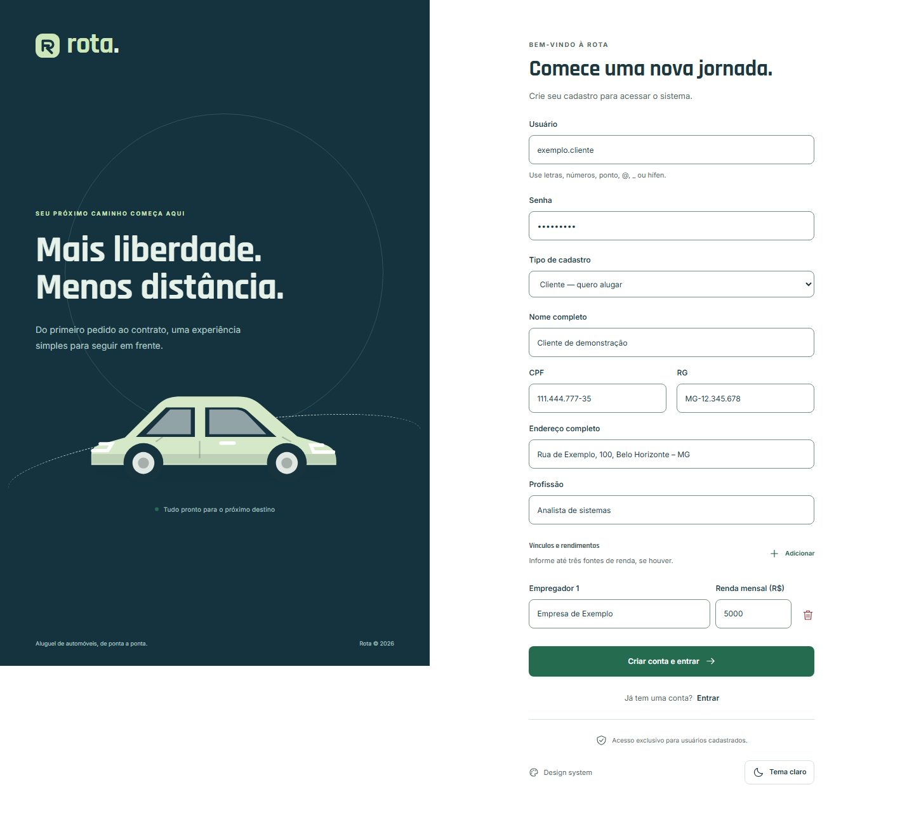</a> |
| [Abrir login](docs/images/login.png) | [Abrir cadastro](docs/images/cadastro.png) |

| Painel do cliente | Frota |
| --- | --- |
| <a href="docs/images/dashboard.png"></a> | <a href="docs/images/frota.png">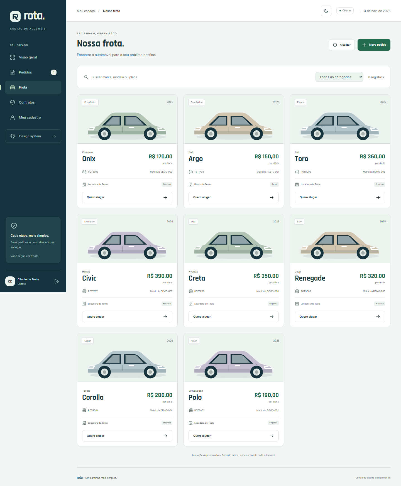</a> |
| [Abrir painel](docs/images/dashboard.png) | [Abrir frota](docs/images/frota.png) |

| Pedidos | Novo pedido |
| --- | --- |
| <a href="docs/images/pedidos.png"></a> | <a href="docs/images/novo-pedido.png">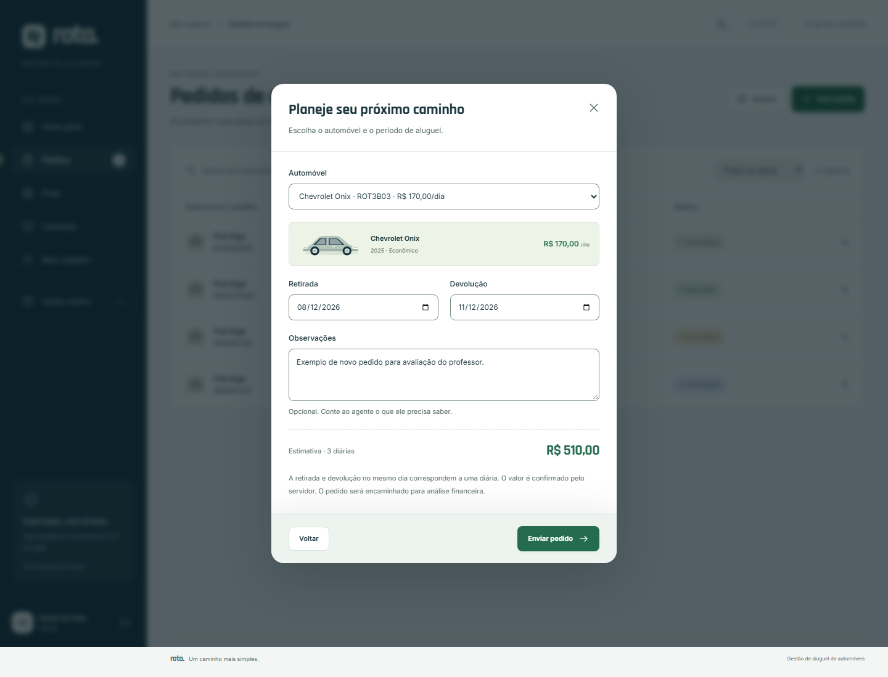</a> |
| [Abrir pedidos](docs/images/pedidos.png) | [Abrir formulário](docs/images/novo-pedido.png) |

| Avaliação financeira | Clientes |
| --- | --- |
| <a href="docs/images/avaliacao.png">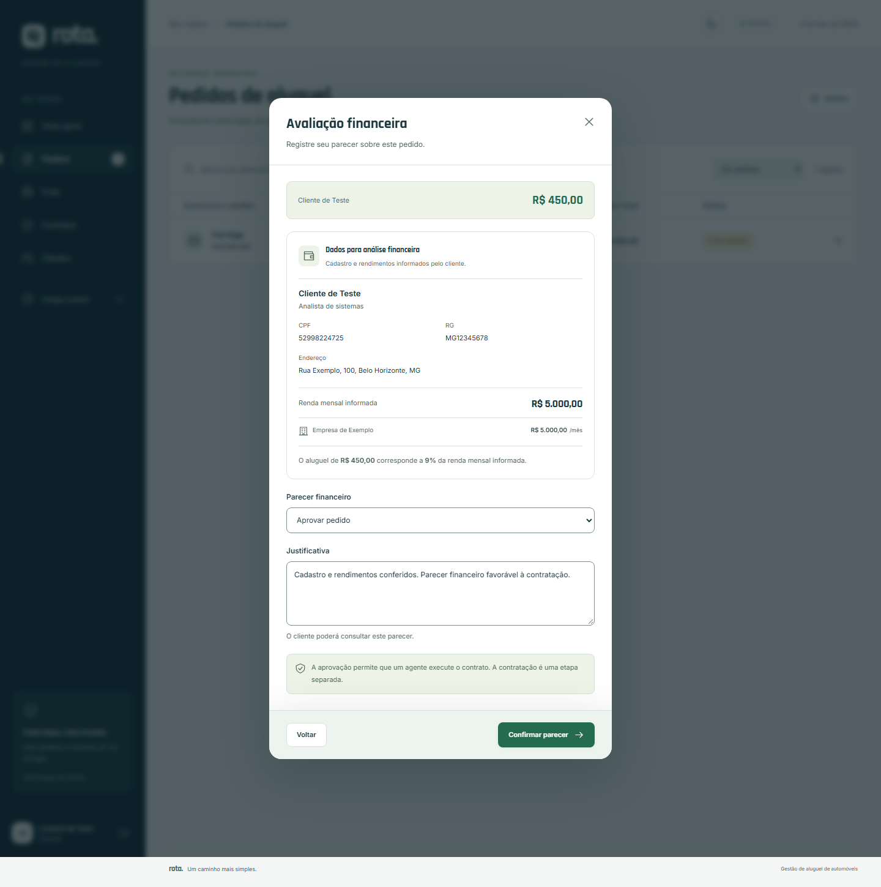</a> | <a href="docs/images/clientes.png">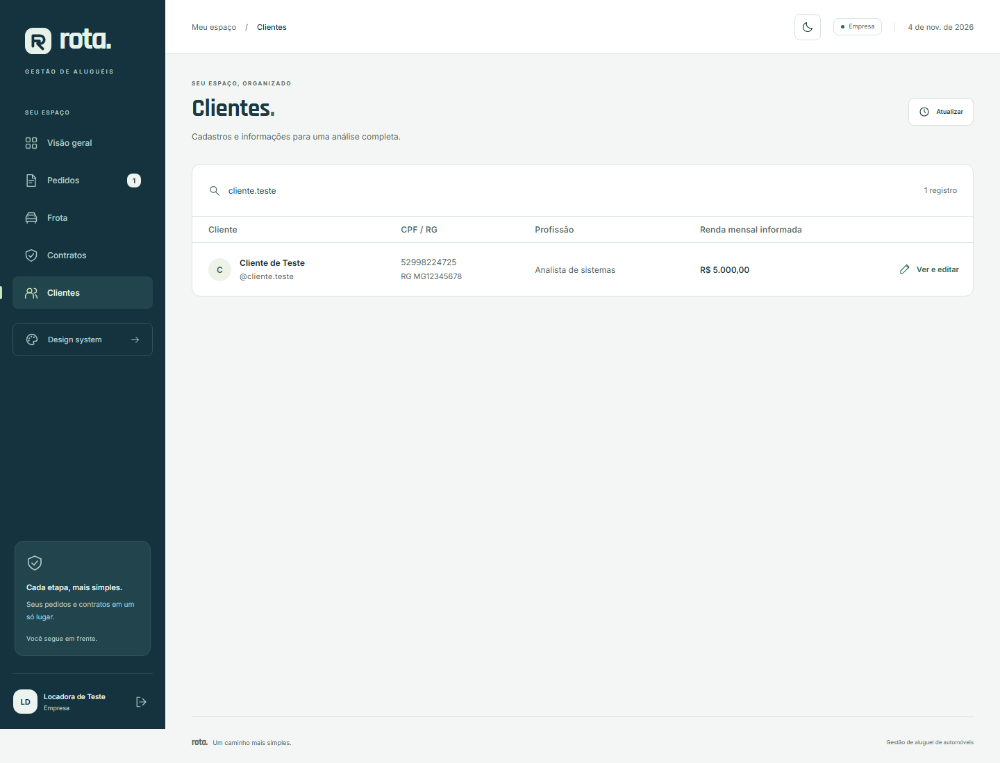</a> |
| [Abrir avaliação](docs/images/avaliacao.png) | [Abrir clientes](docs/images/clientes.png) |

| Cadastro do cliente | Contratos |
| --- | --- |
| <a href="docs/images/perfil.png">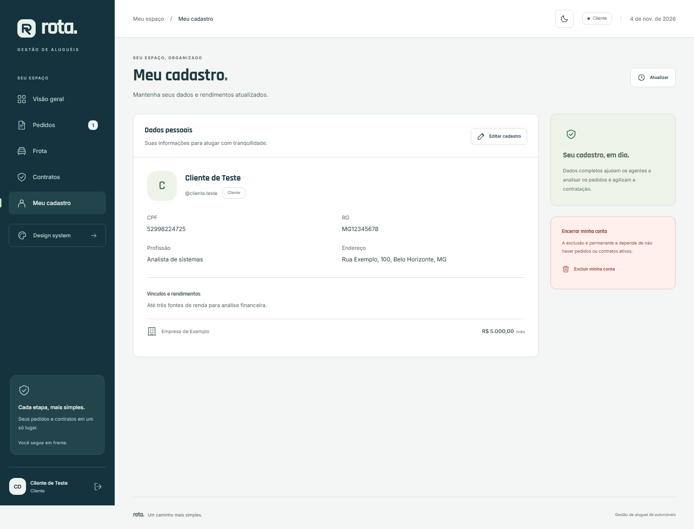</a> | <a href="docs/images/contratos.png">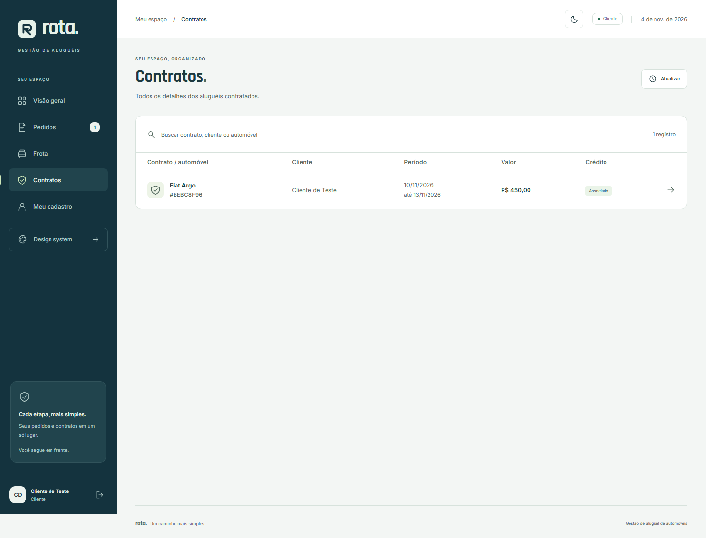</a> |
| [Abrir cadastro](docs/images/perfil.png) | [Abrir contratos](docs/images/contratos.png) |

| Contrato com crédito | Celular |
| --- | --- |
| <a href="docs/images/contrato.png"></a> | <a href="docs/images/mobile.png">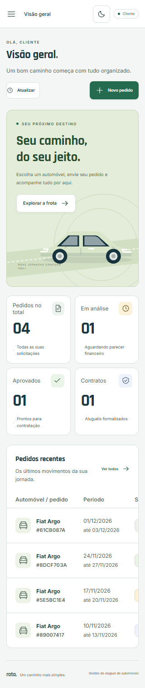</a> |
| [Abrir contrato](docs/images/contrato.png) | [Abrir versão móvel](docs/images/mobile.png) |

| Design System claro | Design System escuro | Frota no tema escuro |
| --- | --- | --- |
| <a href="docs/images/design-system.png">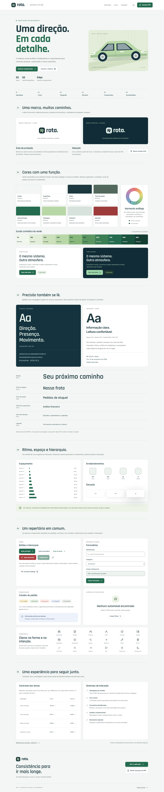</a> | <a href="docs/images/design-system-dark.png">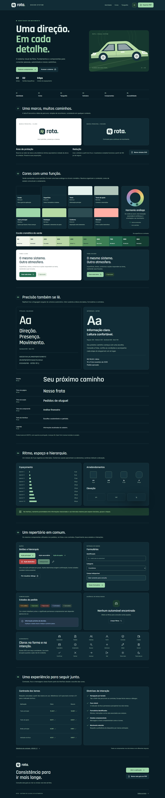</a> | <a href="docs/images/frota-dark.png">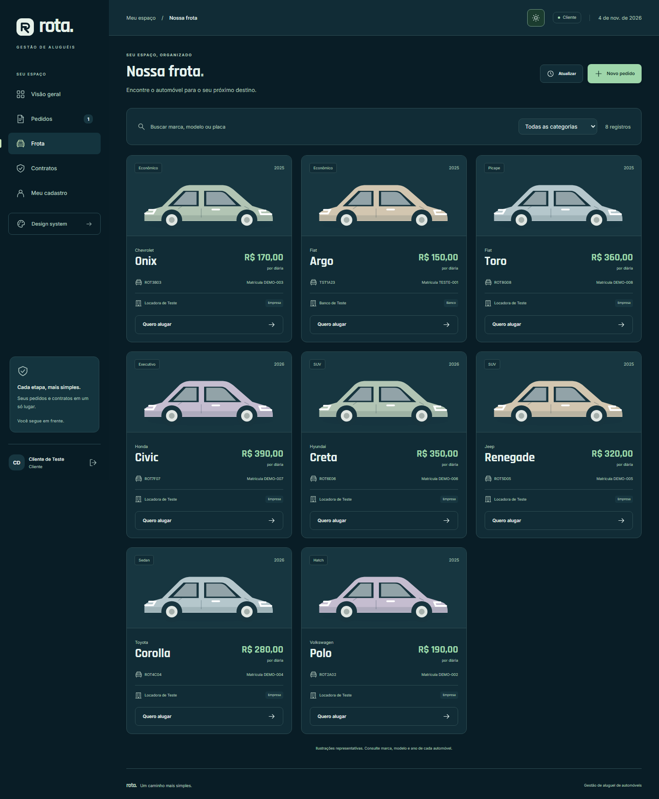</a> |
| [Abrir guia claro](docs/images/design-system.png) | [Abrir guia escuro](docs/images/design-system-dark.png) | [Abrir frota escura](docs/images/frota-dark.png) |

</details>

## Testes

Em `backend`, execute `.\mvnw.cmd test`. Em `frontend`, execute `npm.cmd test` e `npm.cmd run build`.

| Suíte | Testes | Escopo |
| --- | --- | --- |
| `RentalFlowTest` | 16 | Cadastros, pedidos, agentes, contratos e condições preservadas |
| `HttpSecurityTest` | 11 | Sessão, CSRF, autorização, validação e respostas HTTP |
| `ConcurrentRentalTest` | 2 | Dupla contratação e exclusão/criação concorrentes |
| `ContractMigrationTest` | 1 | Evolução V1 → V2 com contratos existentes |
| `frontend/test/api.test.js` | 10 | Cookies, CSRF, 401, cancelamento, erros, 204 e JSON |
| `frontend/test/design-utils.test.js` | 3 | Cálculo de contraste e validação de cores |

As seis suítes somam **43 testes aprovados**. O back-end usa JDK 25 e H2 isolado; os testes HTTP do front-end substituem as respostas de rede e os testes de design validam o cálculo de contraste.

A integração com PostgreSQL/Supabase foi conferida nos fluxos de CRUD, autenticação, propriedade/crédito, datas, concorrência e preservação de contratos. A atualização V2 também foi validada com contratos e contas preexistentes.

Na interface, foram conferidos os três perfis nos temas claro/escuro, em celular e desktop, com teclado, foco, persistência do tema e expiração de sessão. A página `/design` foi verificada nas duas aparências, incluindo contrastes, componentes e exportação.

## Documentações utilizadas

[Spring Boot](https://docs.spring.io/spring-boot/4.0/index.html) · [Spring MVC](https://docs.spring.io/spring-framework/reference/web/webmvc.html) · [Supabase/PostgreSQL](https://supabase.com/docs/guides/getting-started/quickstarts/spring-boot) · [React](https://react.dev/learn) · [Vite](https://vite.dev/guide/) · [PlantUML](https://plantuml.com/) · [Template da disciplina](https://github.com/joaopauloaramuni/desenvolvimento-e-integracao-de-aplicacoes-web/blob/main/TEMPLATES/template_README.md)

## Autores

**Álvaro Barbosa** — [barskosa no GitHub](https://github.com/barskosa).

## Contribuição

Consulte os requisitos antes de alterar comportamentos. Execute os testes e o build, atualize a documentação afetada e preserve as versões anteriores dos modelos UML.

## Agradecimentos

Ao professor João Paulo Carneiro Aramuni, pelo enunciado, pelas orientações da disciplina e pelo template de documentação.

## Licença

Licença de distribuição ainda não definida.
