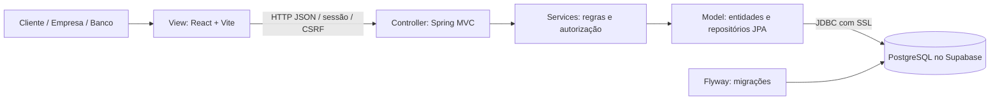
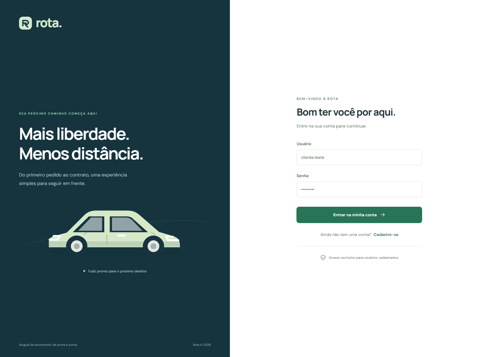
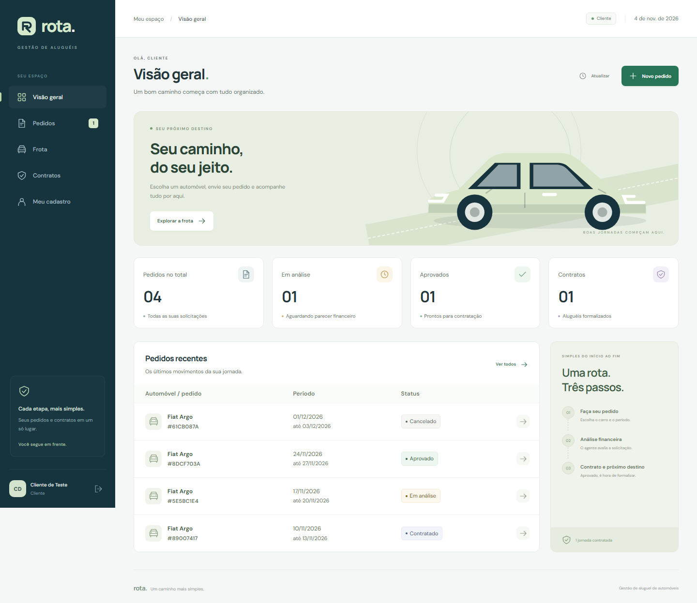
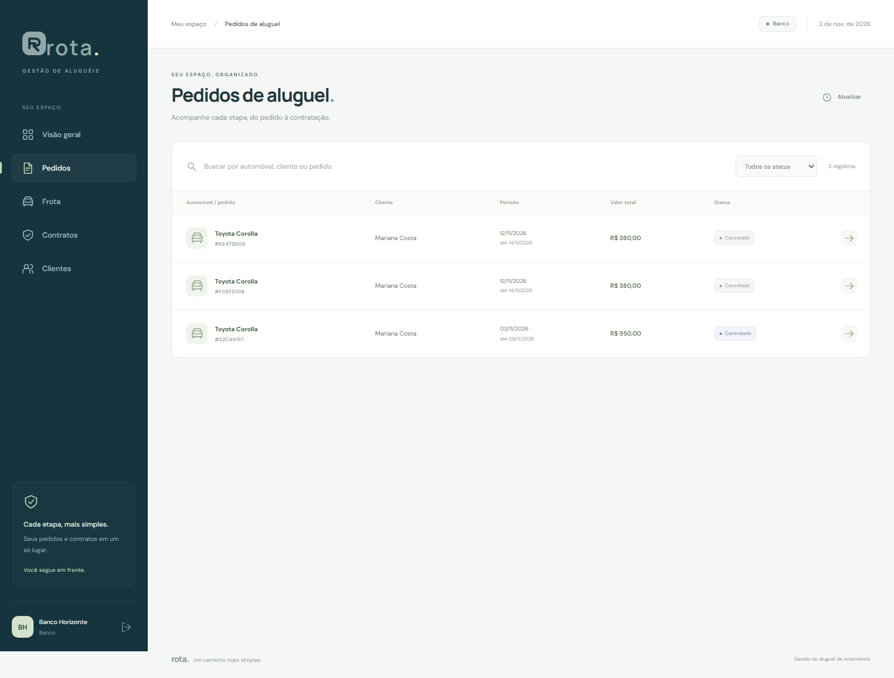
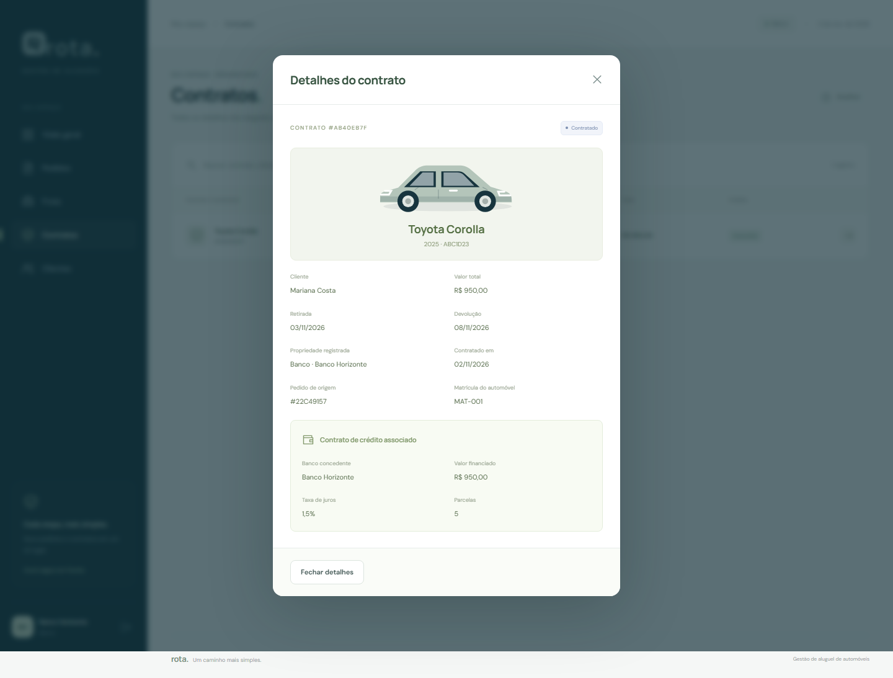

<p align="center"></p>

# Rota — Sistema de Aluguel de Carros

Aplicação web para clientes solicitarem aluguéis e acompanharem sua análise, enquanto empresas e bancos gerenciam a frota, avaliam pedidos e executam contratos.

Projeto acadêmico do **Laboratório 02 de Desenvolvimento e Integração de Aplicações Web (DIAW)**, do curso de Engenharia de Software. Documentação organizada a partir do template fornecido pelo professor João Paulo Carneiro Aramuni.

## Status do projeto

Código da aplicação e documentação disponíveis neste repositório. Back-end compilado com JDK 25, **20 testes aprovados** e conexão real com PostgreSQL no Supabase validada localmente. Cada instalação precisa de suas próprias credenciais em `backend/.env`. O Flyway cria as tabelas; as contas e os automóveis são cadastrados pela interface.

## Índice

- [Links úteis](#links-úteis)
- [Sobre o projeto](#sobre-o-projeto)
- [Funcionalidades principais](#funcionalidades-principais)
- [Tecnologias utilizadas](#tecnologias-utilizadas)
- [Arquitetura](#arquitetura)
- [Instalação e execução](#instalação-e-execução)
- [Deploy](#deploy)
- [Estrutura de pastas](#estrutura-de-pastas)
- [Demonstração](#demonstração)
- [Testes](#testes)
- [Documentações utilizadas](#documentações-utilizadas)
- [Autores](#autores)
- [Contribuição](#contribuição)
- [Agradecimentos](#agradecimentos)
- [Licença](#licença)

## Links úteis

- [Repositório GitHub](https://github.com/barskosa/DiawLab2)
- [Configuração de API e Supabase](docs/CONFIGURACAO.md)
- [Requisitos e rastreabilidade](docs/REQUISITOS.md)
- [Histórias de usuário e critérios de aceite](docs/HISTORIAS-USUARIO.md)
- [Modelagem UML e comparação das versões](docs/MODELAGEM.md)
- [Contrato da API](docs/API-CONTRACT.md)
- [Roteiro da apresentação](docs/ROTEIRO-APRESENTACAO.md)

## Sobre o projeto

O Rota centraliza o processo de aluguel de automóveis: cadastro do contratante, solicitação de período e veículo, parecer financeiro de um agente e emissão de contrato quando aprovado. Clientes, empresas e bancos acessam o mesmo servidor pela aplicação React, com permissões verificadas pelo Spring Boot.

O escopo segue o enunciado do Laboratório 02. As decisões complementares necessárias à implementação, como regras de datas e de transição de status, estão identificadas em [Requisitos](docs/REQUISITOS.md). Os modelos conceituais e os modelos correspondentes ao código estão preservados separadamente em `docs/uml/v1` e `docs/uml/v2`.

## Funcionalidades principais

- Cadastro e login com usuário e senha; sessão protegida e saída da conta.
- CRUD do próprio cadastro de cliente, incluindo RG, CPF, nome, endereço, profissão e até três vínculos de empregador/rendimento.
- Consulta e edição dos dados de clientes pelos agentes.
- Cadastro, consulta, alteração e exclusão de automóveis pelos agentes, com matrícula, ano, marca, modelo e placa.
- Criação, consulta, alteração e cancelamento de pedidos pelos clientes.
- Edição de pedidos e avaliação financeira com parecer por empresas e bancos.
- Contratação somente após aprovação, com propriedade vinculada a cliente, empresa ou banco.
- Crédito opcional concedido pelo banco autenticado, registrando valor, taxa e parcelas no contrato.
- Separação de acesso entre clientes e agentes, validação no servidor e prevenção de aluguéis contratados em períodos conflitantes.

## Tecnologias utilizadas

| Camada | Tecnologia | Uso |
| --- | --- | --- |
| Linguagem do servidor | Java, JDK 25 | Requisito do laboratório |
| Back-end | Spring Boot 4.0.9 / Spring MVC | API e arquitetura MVC |
| Segurança | Spring Security / BCrypt | Sessões, papéis, senha e CSRF |
| Persistência | Spring Data JPA / Hibernate | Mapeamento de entidades e repositórios |
| Banco | Supabase, PostgreSQL | Persistência da execução normal |
| Migrações | Flyway | Criação versionada do esquema `rental` |
| Build Java | Apache Maven / Maven Wrapper | Dependências, testes e empacotamento |
| Front-end | React + Vite / JavaScript / CSS | Páginas dinâmicas e interface responsiva |
| Testes Java | JUnit / Spring Boot Test / H2 | Testes isolados, sem credenciais do Supabase |
| Modelagem | PlantUML | Casos de uso, classes e pacotes versionados |

H2 pertence exclusivamente ao ambiente de testes. A aplicação normal não substitui o Supabase por armazenamento no navegador ou banco simulado.

## Arquitetura



O subsistema de páginas usa React como **View**. O subsistema de gestão concentra **Controllers** Spring MVC, serviços de domínio e o **Model** persistido. Controllers expõem DTOs, os serviços validam permissões e transições, e os repositórios acessam PostgreSQL. A interface nunca recebe a senha do banco.

Clientes e agentes são representados por `AppUser` com papel `CLIENT`, `COMPANY` ou `BANK`. O crédito é opcional e seus dados ficam associados a `RentalContract`. As justificativas e as correspondências entre o modelo conceitual e o código estão em [Modelagem](docs/MODELAGEM.md).

## Instalação e execução

### Pré-requisitos

- Git.
- **JDK 25** com `JAVA_HOME` e `PATH` configurados. Java 17 não atende à versão exigida pelo enunciado.
- Node.js 22.12 ou superior compatível com o Vite usado no projeto; npm.
- Projeto PostgreSQL ativo no Supabase e sua senha de banco.
- Acesso à internet na primeira execução para baixar dependências Maven/npm.

O Maven Wrapper está em `backend/`; não é necessário instalar Maven globalmente.

### Variáveis de ambiente

Copie os arquivos de exemplo a partir da raiz do repositório:

```powershell
Copy-Item backend/.env.example backend/.env
Copy-Item frontend/.env.example frontend/.env
```

Edite `backend/.env` com os valores do painel **Connect → Session pooler** do Supabase:

```dotenv
DB_URL=jdbc:postgresql://SEU_HOST_DO_POOLER:5432/postgres?sslmode=require
DB_USERNAME=postgres.SEU_PROJECT_REF
DB_PASSWORD=SUA_SENHA_DO_BANCO
APP_AGENT_REGISTRATION_CODE=ESCOLHA_UM_CODIGO_PRIVADO
```

Copie host e usuário do seu próprio projeto. O guia [Configuração](docs/CONFIGURACAO.md) explica cada campo, a preparação do Supabase e a resolução de erros. O código de agentes é definido por você e informado apenas ao cadastrar uma empresa ou banco. Cliente não precisa desse código.

O React utiliza a API Spring em `/api`; em desenvolvimento, o Vite encaminha as requisições para `http://localhost:8080`. **Nenhuma chave `anon`, `service_role` ou API externa é necessária.** O login é implementado no Spring Security; não é preciso configurar Supabase Auth.

### Instalação das dependências

No diretório `frontend`:

```powershell
npm.cmd ci
```

As dependências Java são baixadas automaticamente pelo Wrapper ao testar ou iniciar o back-end.

### Inicialização do banco de dados

Após preencher `backend/.env`, o Flyway cria o esquema `rental` e aplica as migrações no primeiro início. O Hibernate valida as tabelas contra as entidades. Use um projeto Supabase destinado ao trabalho; as migrações não inserem contas ou veículos fictícios.

### Como executar a aplicação

Terminal 1, dentro de `backend`:

```powershell
.\mvnw.cmd spring-boot:run
```

Terminal 2, dentro de `frontend`:

```powershell
npm.cmd run dev
```

Abra **http://localhost:5173**. A API atende em **http://localhost:8080/api**. Em Linux/macOS, use `./mvnw` e `npm` nos comandos equivalentes.

### Primeiro uso

1. Defina `APP_AGENT_REGISTRATION_CODE` em `backend/.env` e inicie os dois servidores.
2. Cadastre uma empresa, informe o código e entre nessa conta.
3. Cadastre ao menos um automóvel na frota.
4. Saia, cadastre um cliente com CPF válido e crie um pedido para o veículo.
5. Entre novamente como agente para analisar e aprovar o pedido, depois executar seu contrato.
6. Para demonstrar crédito, cadastre também um banco e faça a concessão autenticado nessa conta.

## Deploy

A entrega contém o código local; não há uma URL pública provisionada. Para uma publicação completa, hospede o processo Java e sirva o build React, preferencialmente no mesmo domínio com `/api` encaminhado ao Spring.

Dentro de `frontend`, gere os arquivos estáticos:

```powershell
npm.cmd run build
```

Dentro de `backend`, gere o executável:

```powershell
.\mvnw.cmd clean package
java -jar target/rota-api-1.0.0.jar
```

Configure as mesmas variáveis de banco e de agente no ambiente do servidor, além de `SESSION_COOKIE_SECURE=true` sob HTTPS. Se o front-end usar outra origem, ajuste `FRONTEND_ORIGIN`, `VITE_API_BASE_URL` e as políticas de cookies de acordo com a topologia. Detalhes em [Configuração](docs/CONFIGURACAO.md#publicação).

## Estrutura de pastas

```text
backend/
  .mvn/                       Configuração do Maven Wrapper
  mvnw / mvnw.cmd             Execução Maven multiplataforma
  pom.xml                     Spring Boot 4.0.9 e Java 25
  src/main/java/br/com/rota/
    config/                   Segurança e configuração
    controller/               Endpoints Spring MVC
    dto/                      Contratos de entrada e saída
    model/                    Entidades e enumerações
    repository/               Persistência Spring Data JPA
    service/                  Regras, autorização e transações
  src/main/resources/
    db/migration/             Migrações Flyway
    application.properties    Configuração sem segredos
  src/test/                   Testes e perfil test
frontend/
  public/                     Marca e recursos estáticos
  src/                        Interface React e cliente da API
  package.json                Scripts e dependências
docs/
  uml/v1/                     Modelagem conceitual inicial
  uml/v2/                     Modelagem alinhada à implementação
  API-CONTRACT.md             Endpoints e dados
  CONFIGURACAO.md             API, Supabase e execução
  HISTORIAS-USUARIO.md        Histórias com critérios de aceite
  MODELAGEM.md                Diagramas e decisões de modelagem
  REQUISITOS.md               Requisitos e rastreabilidade
  ROTEIRO-APRESENTACAO.md      Demonstração e checklist de entrega
```

## Demonstração

Siga o [roteiro de apresentação](docs/ROTEIRO-APRESENTACAO.md) para demonstrar cadastro, pedido, avaliação, contrato e crédito com contas de diferentes papéis. A interface começa vazia e apresenta os dados persistidos pelas ações realizadas.

Os nomes de usuário, senhas e documentos usados na demonstração devem ser dados de teste. Não há conta padrão com privilégios.

As capturas abaixo mostram a aplicação conectada à API Java em um ambiente isolado de testes, com dados fictícios cadastrados pela interface. Não representam um banco Supabase já configurado.

| Login | Painel do cliente |
| --- | --- |
|  |  |
| Pedidos do agente | Contrato com crédito |
|  |  |

Veja também a [interface em uma tela de 320 px](docs/images/mobile.png).

## Testes

No diretório `backend`:

```powershell
.\mvnw.cmd test
```

O perfil `test` usa H2 isolado em modo PostgreSQL, aplica as migrações Flyway e valida as entidades, sem requerer credenciais do Supabase. A execução local em **2 de novembro de 2026**, com JDK 25, terminou com **20 testes, zero falhas e zero erros**:

| Suíte | Quantidade | Comportamentos verificados |
| --- | --- | --- |
| `RentalFlowTest` | 12 | Cadastro/CPF/vínculos, perfis, permissões, pedidos, pareceres, cancelamento, contrato, crédito e períodos conflitantes |
| `HttpSecurityTest` | 8 | API HTTP real, sessão/CSRF, login/logout, convites, validação, isolamento e ciclo completo até contrato com crédito em requisições independentes |

H2 permite testar as regras e as migrações em isolamento. Também foi validada a execução normal com **PostgreSQL real no Supabase**, incluindo aplicação da migração V1, validação das entidades pelo Hibernate e consulta de autenticação pela interface com sessão/CSRF. Essa verificação de conexão é adicional à suíte de 20 testes em H2.

No diretório `frontend`:

```powershell
npm.cmd run build
```

O build verifica o empacotamento da interface. O [roteiro de apresentação](docs/ROTEIRO-APRESENTACAO.md) também lista cenários de validação manual de autorização, cancelamento, dados obrigatórios e limite de rendimentos. Nenhuma porcentagem de cobertura ou validação de um Supabase externo é presumida nesta documentação.

A verificação em Chromium também confirmou cadastro de banco e cliente, cadastro de automóvel, criação e edição de pedido, cancelamento, parecer financeiro e execução de contrato com crédito, usando a API real em ambiente isolado de testes. As cinco páginas do cliente foram verificadas em larguras de **320, 425, 768 e 1440 px**, sem rolagem horizontal no documento e sem erros JavaScript. Tabelas extensas mantêm rolagem dentro do próprio componente.

## Documentações utilizadas

- [Spring Boot 4.0 — documentação oficial](https://docs.spring.io/spring-boot/4.0/index.html)
- [Spring Framework — Spring MVC](https://docs.spring.io/spring-framework/reference/web/webmvc.html)
- [Spring Security — proteção CSRF](https://docs.spring.io/spring-security/reference/servlet/exploits/csrf.html)
- [Supabase — Spring Boot e PostgreSQL](https://supabase.com/docs/guides/getting-started/quickstarts/spring-boot)
- [Supabase — conexões PostgreSQL](https://supabase.com/docs/guides/database/connecting-to-postgres)
- [React](https://react.dev/learn)
- [Vite](https://vite.dev/guide/)
- [Apache Maven Wrapper](https://maven.apache.org/wrapper/)
- [PlantUML](https://plantuml.com/)
- [Template de README da disciplina](https://github.com/joaopauloaramuni/desenvolvimento-e-integracao-de-aplicacoes-web/blob/main/TEMPLATES/template_README.md)

## Autores

**Álvaro Barbosa** — [GitHub: barskosa](https://github.com/barskosa).

## Contribuição

Consulte os requisitos e modelos antes de alterar comportamentos. Trabalhe em uma branch, valide o back-end e o build do front-end e atualize os diagramas quando houver mudança estrutural. As versões anteriores dos modelos devem ser preservadas; mudanças discutidas em aula devem ser registradas com a data e o motivo reais.

## Agradecimentos

Ao professor João Paulo Carneiro Aramuni, pelo enunciado e pelo template de documentação, e ao curso de Engenharia de Software, pelo contexto acadêmico do projeto.

## Licença

Não foi definida uma licença de distribuição. A ausência de licença não equivale a uma autorização de uso irrestrito; os responsáveis devem decidir a licença antes de eventual distribuição pública como projeto reutilizável.
