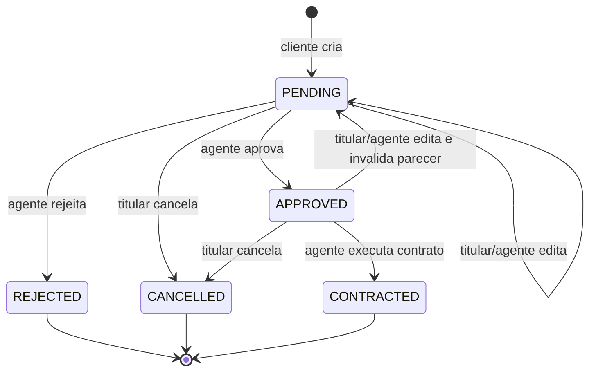

# Modelagem do sistema

O enunciado solicita casos de uso, histórias de usuário, classes, pacotes e revisão dos modelos em relação ao software. Este diretório preserva duas versões explícitas: uma conceitual (`v1`) e outra correspondente às decisões do código (`v2`).

As duas versões foram elaboradas para este trabalho. Não havia modelos anteriores ou feedback de aula no checkout inicial. A separação abaixo documenta a passagem da concepção para a implementação; não afirma que houve uma revisão histórica aprovada pelo professor.

## Versão 1 — modelo conceitual

O modelo inicial descreve o domínio do enunciado antes de escolher os detalhes de persistência: clientes, empresas e bancos como especializações de usuário, pedidos avaliados por agentes e crédito como conceito opcional do contrato.

| Modelo | Fonte editável | Visualização |
| --- | --- | --- |
| Casos de uso | [casos-de-uso.puml](uml/v1/casos-de-uso.puml) | [SVG](uml/v1/casos-de-uso.svg) |
| Classes | [classes.puml](uml/v1/classes.puml) | [SVG](uml/v1/classes.svg) |
| Pacotes / visão lógica | [pacotes.puml](uml/v1/pacotes.puml) | [SVG](uml/v1/pacotes.svg) |

### Casos de uso conceituais


### Classes conceituais


### Pacotes conceituais


## Versão 2 — modelo da implementação

Os nomes das classes e pacotes abaixo correspondem ao Java em `backend/src/main/java/br/com/rota`. A View é implementada em `frontend/src`, usando os DTOs da API.

| Modelo | Fonte editável | Visualização |
| --- | --- | --- |
| Casos de uso | [casos-de-uso.puml](uml/v2/casos-de-uso.puml) | [SVG](uml/v2/casos-de-uso.svg) |
| Classes persistidas | [classes.puml](uml/v2/classes.puml) | [SVG](uml/v2/classes.svg) |
| Pacotes / MVC | [pacotes.puml](uml/v2/pacotes.puml) | [SVG](uml/v2/pacotes.svg) |

### Casos de uso implementados


O ator `Agente` representa a generalização de empresa e banco. Clientes consultam apenas seus dados. Recursos de negócio exigem autenticação; cadastro e entrada ficam disponíveis ao visitante. A concessão de crédito aparece como extensão opcional da contratação e é restrita ao banco autenticado.

### Classes persistidas


O diagrama representa entidades, enumerações e o valor embutido `Employment`. Os serviços, repositórios e DTOs estão na visão de pacotes. Cardinalidades refletem a regra de domínio: por exemplo, um pedido pode não ter contrato e um cliente possui no máximo três vínculos, embora o máximo seja validado no serviço.

### Pacotes e MVC


| Elemento | Responsabilidade | Código |
| --- | --- | --- |
| View | Páginas, formulários e navegação | `frontend/src/App.jsx`, `forms.jsx`, `components.jsx` |
| Cliente HTTP | JSON, sessão, token CSRF e tratamento de falhas | `frontend/src/api.js` |
| Controller | Receber HTTP, validar entradas e entregar DTOs | `backend/src/main/java/br/com/rota/controller` |
| Services | Regras de domínio, autorização e transações | `AuthService`, `RentalService` |
| Model | Estado do domínio e relações | `AppUser`, `Employment`, `Vehicle`, `RentalOrder`, `RentalContract` |
| Repository | Consultas e persistência JPA | `UserRepository`, `VehicleRepository`, `OrderRepository`, `ContractRepository` |
| DTO | Delimitar os dados expostos sem serializar entidades/senhas | `dto/ApiDtos.java` |
| Config / Exception | Segurança e apresentação consistente dos erros | Pacotes `config` e `exception` |

## Comparação das versões e justificativas

| Conceito da v1 | Implementação na v2 | Justificativa |
| --- | --- | --- |
| `Usuario`, `Cliente`, `Agente`, `Empresa`, `Banco` em hierarquia | Uma entidade `AppUser` com enum `Role` | Credenciais centralizadas; regras diferenciam pessoas e agentes pelo papel sem duplicar tabelas de login |
| Vínculo empregatício | `Employment` como `@Embeddable` e coleção em `AppUser` | Valor pertence ao cadastro e não tem ciclo de vida independente; limite de três no serviço |
| Automóvel | `Vehicle` | Preserva matrícula, ano, marca, modelo e placa; acrescenta diária/categoria para solicitar e calcular aluguel |
| Pedido e parecer financeiro | `RentalOrder`, `OrderStatus`, `reviewNotes`, `reviewedBy` | Parecer e responsável pertencem à decisão sobre o pedido; não requerem entidade independente |
| Contrato de aluguel | `RentalContract` com relação única ao pedido | Um pedido gera no máximo um contrato após aprovação |
| Contrato de crédito | Atributos opcionais em `RentalContract` e referência `bank` | Crédito é concedido no momento da contratação e não possui operações próprias no escopo do protótipo |
| Proprietário de automóvel | `Vehicle.owner` e `RentalContract.owner`, ambos `AppUser` | O papel do proprietário permite cliente, empresa ou banco; contrato preserva a definição daquela operação |
| Subsistemas de gestão e páginas | Back-end Spring MVC e front-end React | Separação das duas responsabilidades indicadas no enunciado com comunicação HTTP |
| Autenticação conceitual | Spring Security, sessão, BCrypt e CSRF | Define como credenciais e ações são protegidas no sistema executável |
| Cancelamento de pedido | Transição para `CANCELLED` | Mantém histórico consultável em vez de remover a solicitação |
| Exclusão de cliente | Desativação com anonimização e bloqueio de compromissos ativos | Preserva integridade referencial de pedidos/contratos históricos sem manter a identificação removida |

## Ciclo de vida do pedido



O valor é calculado no servidor. A aprovação registra o parecer, e a contratação revalida a disponibilidade do automóvel. Alterar um pedido aprovado o devolve à análise para evitar um contrato baseado em condições diferentes das aprovadas.

## Manutenção dos modelos

1. Preserve as fontes `.puml` e as versões anteriores.
2. Ao alterar entidades, associações, permissões ou fluxo, atualize os modelos correspondentes.
3. Crie `v3`, `v4` etc. quando uma revisão significativa precisar ser apresentada como nova versão.
4. Registre a data, o requisito/feedback real, os arquivos alterados e a justificativa.
5. Reavalie a [matriz de requisitos](REQUISITOS.md) e as [histórias](HISTORIAS-USUARIO.md) após a mudança.

Os SVGs são artefatos de visualização gerados a partir das fontes PlantUML. Podem ser regenerados com uma instalação do [PlantUML](https://plantuml.com/):

```powershell
java -jar CAMINHO_DO_PLANTUML.jar -tsvg -charset UTF-8 docs/uml/v1/*.puml docs/uml/v2/*.puml
```

As fontes declaram `!pragma layout smetana` para renderização pelo mecanismo Java. PlantUML é uma ferramenta de documentação e não é dependência da aplicação.
